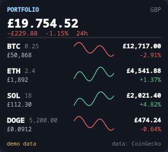

# cryptomon

Transparent, draggable desktop crypto portfolio monitor (PySide6) for Linux, in
the style of [sysmon-widget](https://github.com/kranmal/sysmon-widget).
Add the coins you hold and watch their live value, 24h change and 7 day trend.

## Features
- Total portfolio value and 24h change in money and percent
- Per coin: amount, price, value, 24h change, 7 day sparkline
- Add any coin CoinGecko lists (search by name or symbol), edit or remove it later
- GBP, USD or EUR; adjustable opacity; optional click-through
- Tall lists stop at the screen height and scroll (mouse wheel, with a slim scrollbar)
- Opens on the left edge of the screen (or right, or where your desktop puts it)
- System tray icon: click to hide or show the widget, hover for your portfolio total, right-click for the full menu
- Remembers your coins, currency, refresh interval and opacity

## Requirements
- Linux, Python >= 3.9, a desktop session (X11 or Wayland), internet access
- `PySide6` (installed automatically). No API key needed.

## Install

    git clone https://github.com/kranmal/cryptomon && cd cryptomon
    ./install.sh        # or: pipx install .

## Usage
Run `cryptomon`.

- Left-drag to move
- Right-click, **Add coin…**: search, pick a coin, enter how much you hold
- Change a coin's amount: menu, **Update coin**, pick the coin (or double-click its row). Remove it with **Remove coin** or right-click on its row
- Adding a coin you already hold adds to its amount; to set a new total use **Update coin**
- Click the ≡ button (top right) or right-click for the menu: currency, refresh interval, opacity, refresh, click-through and quit

Prices refresh every minute by default; pick 30 seconds to 5 minutes under right-click, **Refresh every**. Try it with fake data and no network:
`cryptomon --demo`.

Autostart: copy `data/cryptomon.desktop` to `~/.config/autostart/`.

Uninstall: `pipx uninstall cryptomon` and remove
`~/.local/share/applications/cryptomon.desktop`.

## Privacy
Your holdings are stored only in `~/.config/cryptomon/config.json` (mode 600).
The app sends CoinGecko the coin ids it needs (for example `bitcoin`) and your
chosen currency. It never sends how much you hold. No accounts, no wallet
addresses, no exchange keys.

## Notes
- Data from [CoinGecko](https://www.coingecko.com)'s free public API. It is
  rate limited; if it says "rate limited, retrying" it will try again next minute.
- Prices are indicative, not trading quotes. This is not financial advice.
- Wayland: apps cannot place their own windows, so on KDE Plasma cryptomon asks KWin to move it to the chosen edge (menu, **Open at**). On other Wayland desktops it stays where the compositor puts it; X11 works everywhere. Always-on-bottom also depends on the compositor.
- The tray icon needs a desktop with a system tray (KDE, most others via an extension). Without one the widget just stays on the desktop.
- Tests: `PYTHONPATH=src python3 -m unittest discover -s tests`

MIT licensed.
