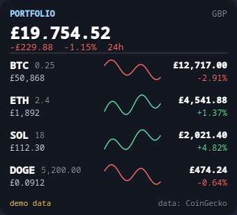
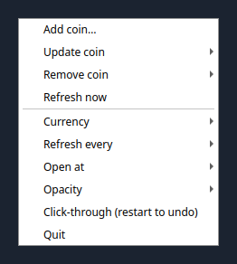

# cryptomon user guide



## Starting it
Run `cryptomon`, or pick **Crypto Monitor** from your app menu. It opens on the
left edge of the screen. `cryptomon --demo` shows made-up coins with no network
and without touching your saved settings.

To start it at login, copy `data/cryptomon.desktop` to `~/.config/autostart/`.

## The widget
- **Header:** total portfolio value and the 24 hour change in money and percent.
  The **≡** button (top right) opens the menu.
- **Rows:** one per coin. The left shows the symbol, how much you hold and the
  price. The right shows the value of your holding and the 24 hour change. The
  line in the middle is the last 7 days (green if up, red if down).
- **Footer:** when prices last updated, or a warning such as "rate limited,
  retrying". Prices are from CoinGecko.
- **Move it:** left-drag anywhere that isn't the menu button.
- **Long lists:** the widget stops at the screen height and the rows scroll with
  the mouse wheel; a slim scrollbar on the right shows where you are.

## Managing coins


| Do this | How |
| --- | --- |
| Add a coin | Menu, **Add coin…**. Search by name or symbol, pick one, enter how much you hold. |
| Change an amount | Menu, **Update coin**, pick the coin. Or double-click its row. |
| Remove a coin | Menu, **Remove coin**, or right-click its row and choose Remove. |

Adding a coin you already hold **adds** the amount to what you have. To set a new
total, use **Update coin** instead.

## Menu reference
- **Refresh now:** fetch prices immediately.
- **Currency:** GBP, USD or EUR.
- **Refresh every:** 30 seconds, 1, 2 or 5 minutes (default 1 minute).
- **Open at:** where the widget starts: left edge, right edge, or wherever your
  desktop puts it. Takes effect straight away.
- **Opacity:** clear, light, medium or dark background.
- **Click-through:** lets mouse clicks pass through the widget. Restart the app to
  undo it, so use it last.
- **Hide to tray / Quit.**

## System tray icon
- Left-click: hide or show the widget.
- Hover: your portfolio total and 24 hour change.
- Right-click: the same menu, with **Show widget** or **Hide widget** at the top.

## Where your data lives
Settings are in `~/.config/cryptomon/config.json` (mode 600):

```json
{
  "currency": "gbp",
  "opacity": 130,
  "interval": 60,
  "placement": "left",
  "pos": null,
  "holdings": [
    { "id": "bitcoin", "symbol": "BTC", "name": "Bitcoin", "amount": 0.25 }
  ]
}
```

`id` is the CoinGecko coin id (the part of a coin's CoinGecko URL, for example
`bitcoin` or `ripple`). You can edit the file by hand while the app is closed.
Invalid entries are ignored rather than crashing the app.

**Privacy:** only coin ids and your chosen currency are sent to CoinGecko. The
amounts you hold never leave your machine. There are no accounts, wallet
addresses or exchange keys.

## Troubleshooting
- **"rate limited, retrying"**: CoinGecko's free API limits how often it answers.
  The widget retries on the next refresh. Choose a longer **Refresh every** if it
  happens often.
- **"offline, retrying"**: no network or CoinGecko is unreachable. Nothing is lost.
- **Prices missing for a coin (shows "…")**: the coin id may be wrong, or CoinGecko
  has no price for it. Remove it and add it again through the search.
- **Widget does not open on the left**: on Wayland an app cannot place its own
  window. On KDE Plasma cryptomon asks KWin to do it. On other Wayland desktops it
  stays where the compositor puts it; X11 works everywhere.
- **No tray icon**: your desktop needs a system tray. Without one the widget just
  stays on the desktop, and **Hide to tray** is not offered.
- **Widget did not grow after adding a coin**: update to the latest version. Older
  builds could be ignored by KWin when resizing right after a dialog.
- **Uninstall**: `pipx uninstall cryptomon` (or delete `~/.local/share/cryptomon-venv`
  and `~/.local/bin/cryptomon`), then remove
  `~/.local/share/applications/cryptomon.desktop`,
  `~/.config/autostart/cryptomon.desktop` and `~/.config/cryptomon/`.

Not financial advice. Prices are indicative, not trading quotes.
